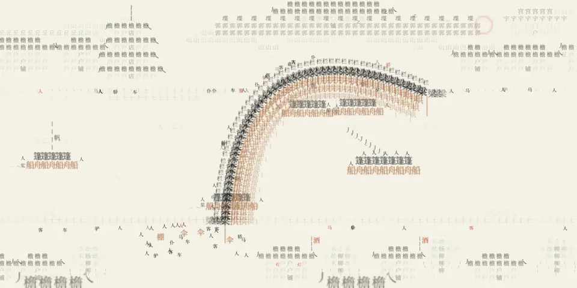
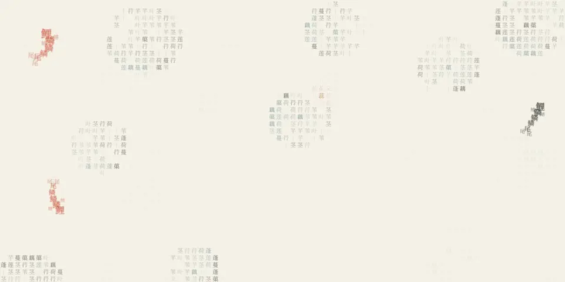
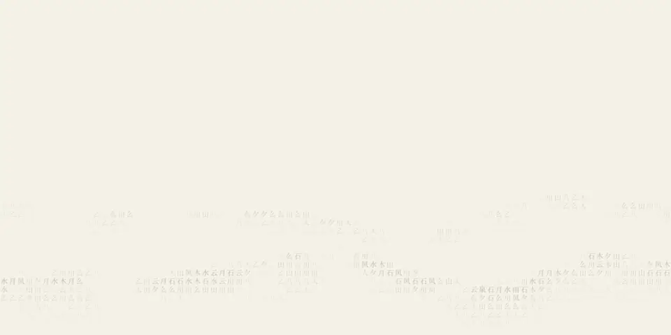

<div align="center">

# 墨池 Inkpond

[简体中文](README.md) · **English**

An ink-wash background of Chinese glyphs for the web.

[](https://github.com/shin4/inkpond/actions/workflows/ci.yml)
[](https://www.npmjs.com/package/inkpond)
[](LICENSE)

[**Live demo**](https://shin4.github.io/inkpond/en/) · [Session demo](https://shin4.github.io/inkpond/session/)

</div>

<picture>
  <source media="(prefers-color-scheme: dark)" srcset="docs/images/qingming-dark.webp" />
  
</picture>

Chinese characters, laid out by stroke density, become a picture: distant hills in mist, a lotus pond with koi, a slowly unrolling handscroll of *Along the River During the Qingming Festival*, the twenty-four solar terms, changing with the date, or a deep sea with a whale passing beneath it. The pointer stirs ripples, a click drops ink that spreads and fades, and page content keeps a clear zone around it.

- **Five scenes**: hills, lotus pond, the Qingming scroll, the 24 solar terms that follow the date, and a whale in the deep sea, with optional pale colour
- **Responsive**: ripples follow the pointer, clicks drop ink, koi flee and come to feed, walkers scatter from the ink, the whale dives when touched
- **Out of the way**: content gets a clear zone, and koi, boats and walkers steer around it
- **Light**: Canvas 2D, zero runtime dependencies, under 2 ms of script per frame, steps down on weak devices
- **React optional**: an `<InkPond />` component, or use it without React

## Scenes

| `scene` | Picture | What moves |
| --- | --- | --- |
| `shanshui` (default) | Two ranges of distant hills, mist drifting past | The mist |
| `lotus` | A lotus pond seen from above: leaves, flowers, duckweed | Koi swim around content, scatter from the pointer and come to where ink drops |
| `qingming` | The Qingming handscroll: mountains and city walls, a pagoda and gate towers, taverns along both banks, a timber rainbow bridge across the river | The scroll unrolls to the left, boatmen pole, walkers cross the bridge, ink scatters them |
| `jieqi` | The 24 solar terms (节气), one picture each; by default the term today falls in | See the table below; if the page stays open into the next term, it bleeds over to it in ink |
| `beiming` | 北冥, the northern deep: the open sea from above, a whale's shadow under the swell | The whale glides by, rising and sinking about once a minute and leaving flat calm footprints when shallow; touched by the pointer it dives, and ink draws it near |

The lotus, Qingming, solar-term and whale scenes use a touch of pale colour (vermilion, rouge, ochre, indigo); set `tint={false}` for ink only.

### The 24 solar terms

`scene="jieqi"` finds today's term from the sun's ecliptic longitude (to within about a quarter of an hour). Pin one with `term`, or show a given day's with `date`:

```tsx
<InkPond scene="jieqi" />                          // today's term, following the clock
<InkPond scene="jieqi" term="shuangjiang" />       // Frost's Descent only
<InkPond scene="jieqi" date={new Date(2027, 0, 20)} /> // that day's term (Major Cold)
```

`jieqiAt(date)` returns the `term` a moment falls in, and `JIEQI` lists all 24 (`id`, name, longitude).

| Term | `term` | Picture | On a click / the pointer |
| --- | --- | --- | --- |
| 立春 Start of Spring | `lichun` | Ice cracks open from a point; sprouts (芽) push up along the cracks | The ink starts a new crack |
| 雨水 Rain Water | `yushui` | Slanting 雨 rain rings the water below | The pointer sets the wind |
| 惊蛰 Awakening of Insects | `jingzhe` | Lightning splits the frame with a flash; 虫 insects are thrown from the ground | Lightning strikes the ink |
| 春分 Spring Equinox | `chunfen` | Half day, half night, split by a living vermilion seam that swallows cross | The seam follows the pointer |
| 清明 Clear and Bright | `qingming` | Willow strands sway; a vermilion kite; drizzle | The pointer parts the willows |
| 谷雨 Grain Rain | `guyu` | Peonies open in layers; petals drift in the rain | A new flower opens at the ink |
| 立夏 Start of Summer | `lixia` | Frog croaks ring out and interfere | Frogs croak faster near the pointer; the ink rings too |
| 小满 Grain Buds | `xiaoman` | Waves roll through the wheat | The wheat bows under the pointer |
| 芒种 Grain in Ear | `mangzhong` | A vermilion planting line sweeps the paddy, leaving rows of seedlings | The line moves to the ink |
| 夏至 Summer Solstice | `xiazhi` | A vermilion sun with turning rays; heat shimmer on the ground | The sun drifts after the pointer |
| 小暑 Minor Heat | `xiaoshu` | Heat rises in warped plumes; cicadas call | A cool breeze at the pointer |
| 大暑 Major Heat | `dashu` | Fireflies wander over night grass, trailing light | Fireflies gather to the pointer |
| 立秋 Start of Autumn | `liqiu` | An empty frame; one leaf (叶) falls into the water | The pointer blows the leaf aside |
| 处暑 End of Heat | `chushu` | A turbulent front pushes the vermilion heat off the frame; a hawk circles | Cooling at the pointer |
| 白露 White Dew | `bailu` | Dew beads swell on the grass, then run down | A touched bead runs |
| 秋分 Autumn Equinox | `qiufen` | A full moon halved by a slowly turning vermilion diameter | The diameter points at the pointer |
| 寒露 Cold Dew | `hanlu` | Geese fly in a skein that shifts between the 人 and 一 formations; chrysanthemums below | The skein avoids the pointer |
| 霜降 Frost's Descent | `shuangjiang` | Six-armed frost grows in from the edges; vermilion maple leaves fall | The pointer's warmth melts the frost |
| 立冬 Start of Winter | `lidong` | Waves slow until they freeze into ice, crack and thaw | The ink adds a wave source |
| 小雪 Minor Snow | `xiaoxue` | Sparse snow at three depths | The pointer blows the flakes aside |
| 大雪 Major Snow | `daxue` | Driving snow builds drifts on the ground | The pointer sets the wind |
| 冬至 Winter Solstice | `dongzhi` | In the longest night a vermilion 阳 pushes back the ink; a ring of 81 dots turns to plum one by one (counting the nines) | 阳 follows the pointer |
| 小寒 Minor Cold | `xiaohan` | A plum branch grows stroke by stroke and blossoms at its tips | Blossoms open at the ink |
| 大寒 Major Cold | `dahan` | Fireworks burst over a frozen grid | A firework goes up at the ink |

| Lotus | Shanshui |
| --- | --- |
|  |  |

## Install

```bash
npm i inkpond
```

The React component also needs `react` 18 or later (an optional peer dependency).

<details>
<summary>Installing the latest commit from GitHub</summary>

```bash
npm i github:shin4/inkpond
```

A GitHub install builds `dist/` on the spot:

- npm 11 notes dependencies with build scripts (`allow-scripts`) and installs anyway; if your config blocks dependency scripts, run `npm approve-scripts inkpond`.
- bun runs no dependency scripts by default and does not install a dependency's dev dependencies. Your project needs TypeScript, and inkpond must be trusted:

  ```bash
  bun add -d typescript
  bun add github:shin4/inkpond
  bun pm trust inkpond
  ```

</details>

## Usage

### React

```tsx
import { InkPond } from "inkpond/react";
import "inkpond/inkpond.css";

<main style={{ position: "relative" }}>
  <InkPond scene="lotus" active={isEmpty} />
  <section data-inkpond-avoid="">…greeting…</section>
  <form data-inkpond-avoid="">…composer…</form>
</main>
```

- The canvas fills the **nearest positioned parent** and takes pointer events from it.
- Elements with `data-inkpond-avoid` get a clear zone, including ones that appear later.
- `active` says whether this view is on screen; a background tab pauses by itself.
- Other options are read once on mount; change the `key` to remount with new ones.
- The component is marked `"use client"`, so it renders straight from a Next.js App Router Server Component. For Vue and Svelte, see the [FAQ](https://shin4.github.io/inkpond/en/faq/).

### Without React

```ts
import { createInkPond } from "inkpond";
import "inkpond/inkpond.css";

const pond = createInkPond(document.querySelector("canvas.inkpond")!, {
  scene: "qingming",
});
pond.setActive(false); // when this view is hidden
pond.destroy();        // on unmount
```

### Stirring the water from code

The page can ripple and drop ink itself, say a ripple per keystroke and a drop on send. Coordinates are viewport coordinates (`clientX` / `clientY`):

```ts
pond.ripple(x, y, 0.4); // one ring of waves, strength 0–1, default 1
pond.drop(x, y);        // a drop of ink; refused (false) on a clear-zone element
```

In React, `pondRef` gives you the same object:

```tsx
const pondRef = useRef<InkPond | null>(null); // the InkPond type from "inkpond"
<InkPond pondRef={pondRef} />
// later: pondRef.current?.ripple(x, y)
```

Both do nothing while paused, in reduced motion and on the still tier.

## Options

| Option | Default | Meaning |
| --- | --- | --- |
| `scene` | `"shanshui"` | `shanshui` / `lotus` / `qingming` / `jieqi` / `beiming` |
| `term` | today's term | `jieqi` only: show this solar term, e.g. `"qingming"` |
| `date` | now | `jieqi` only: show this day's term, and stay on it |
| `tint` | `true` | Draw pale colour; `false` for ink only |
| `active` | `true` | Whether the view is on screen; background tabs always pause |
| `strength` | `0.45` | Ink depth of the scene; ripples and ink drops are not affected |
| `waveSpeed` | `1` | Wave speed multiplier |
| `cellSize` | the tier's (16) | Glyph cell in CSS px, 12–48: the glyph size; smaller draws more glyphs and costs more; after a step down it never goes below that tier's cell (22 on lite) |
| `levels` | per scene | Glyph levels for the main ground (the hills, the water in lotus and Qingming, or the sea in beiming), light to dark; other glyphs need your own font; not used by the solar terms |
| `reducedMotion` | follows the system | When on, draws one still picture and ignores the pointer |
| `avoidAttribute` | `data-inkpond-avoid` | Attribute that marks clear zones |
| `avoidPadding` | `20` | Fully clear margin around those elements (CSS px) |
| `avoidFade` | `140` | Width of the fade back to full ink (CSS px) |
| `fontUrl` | the scene's subset | `null` to use the fallback fonts only |
| `fontFamily` / `fallbackFonts` | per scene / serif stack | Font name and fallbacks |
| `tierStorageKey` | `inkpond.tier` | localStorage key that remembers a step down; `null` to forget |

**Colour**: the ink is the canvas `color`, settable with the CSS variable `--inkpond-ink`; `--inkpond-alpha` is the opacity of the darkest ink. Pale colours come from `--inkpond-zhu` (vermilion), `--inkpond-yanzhi` (rouge), `--inkpond-zhe` (ochre) and `--inkpond-huaqing` (indigo). `inkpond.css` handles `prefers-color-scheme` and `.dark` / `data-theme="dark"` on `<html>`; colours follow theme changes.

## Performance

Each glyph is rasterised once into an atlas, and every frame only copies from it. The still parts of a scene are computed once per size, and slow layers such as mist are recomputed every 4 frames.

- **Frame rate on demand**: tier rate while the water moves; about 20–24 fps when only koi, boats or the scroll move; 10 fps when only mist drifts; stops after 30 s without input and wakes on the next pointer move.
- **Three tiers**: standard (60 fps, 16px cells), lite (30 fps, 22px cells) and still. `cellSize` changes the cell: larger is cheaper, while smaller draws more glyphs by area (12px about 1.8× as many as 16px), and a stepped-down tier still keeps its own cell as the floor. Software rendering starts on still and weak devices on lite; sustained jank steps down at runtime, remembered for 30 days.
- **Accessibility**: pauses in hidden tabs; reduced motion draws one still picture; the canvas is hidden in forced-colours mode.

<details>
<summary>Measurements</summary>

Headless Chrome, 1920×1080, DPR 1.5, script time per frame as median / p95, budget 8 ms:

| Scene | Calm water | Pointer stirring the whole screen | Slow-layer recompute (every 4 frames) |
| --- | --- | --- | --- |
| Shanshui | 0.2 / 0.3 ms | 0.9 / 1.8 ms | 0.1 ms |
| Lotus | 0.2 / 0.3 ms | 1.1 / 1.9 ms | < 0.1 ms |
| Qingming | 0.7 / 0.9 ms | 1.3 / 1.7 ms | 0.2 ms |
| Beiming | 0.4 / 0.8 ms | as lotus, p95 about 0.4 ms higher | 0.4 ms |

Nearly all of it is image copies. All 24 solar-term pictures are drawn to the same budget: at most about 2,600 glyphs per calm frame at that size, about as many as Qingming. With the GPU off and CPU rasterisation, a fully stirred frame takes about 9 ms, which is what the starting tier and the step-down are for. Step-down rules: a median over the last 10 frames above 16 ms, or a frame gap over 60 ms, goes straight to still; every 60 frames, a p95 above 8 ms or a gap over 40 ms steps down one tier. The atlas is a 16-column grid (Qingming at DPR 2 is 640×1400px), well inside the 4096px texture limit of many mobile GPUs.

</details>

## Fonts

Each scene ships a subset of Source Han Serif SC Medium (SIL OFL 1.1) with only the glyphs it uses, loaded when the scene is:

| File | Glyphs | Size |
| --- | --- | --- |
| `inkpond-shanshui.woff2` | 39 | about 10 KiB |
| `inkpond-lotus.woff2` | 66 | about 16 KiB |
| `inkpond-qingming.woff2` | 101 | about 21 KiB |
| `inkpond-jieqi.woff2` | 129 | about 29 KiB (one for all 24 terms) |
| `inkpond-beiming.woff2` | 21 | about 6 KiB |

The OFL forbids modified versions from using the Reserved Font Name "Source", so the subsets are renamed **Inkpond Glyphs**. The licence and a note of the changes are in `src/assets/OFL.txt`.

## Development

```bash
bun install
bun run dev          # project page at http://localhost:5173/, session demo at /session/
bun run test         # unit tests
bun run smoke:pack   # packaging smoke test: install from the tarball and from git, then import, type-check and bundle
bun run build        # library to dist/
bun run build:demo   # demo pages to dist-demo/
```

After changing the glyphs any scene uses, rebuild all subsets from the original OTF (needs `bun` and `uv`; the font is in Adobe's `adobe-fonts/source-han-serif` repository):

```bash
scripts/build-font.sh path/to/SourceHanSerifSC-Medium.otf
```

The project page source is `demo/index.html`, the FAQ is `demo/faq/` and the English versions are in `demo/en/`; the build prerenders them to static HTML with structured data, next to an [llms.txt](https://shin4.github.io/inkpond/llms.txt) and the complete [llms-full.txt](https://shin4.github.io/inkpond/llms-full.txt) for AI assistants. Every push to `main` redeploys them through `.github/workflows/pages.yml`.

## Thanks

Inkpond grew from [stackedlol/ascii-sharks](https://github.com/stackedlol/ascii-sharks): a sea of characters behind the page that swims, avoids content and answers the pointer. Inkpond turns the idea into ink wash and Chinese glyphs, written from scratch without code from the original. Thanks to [@stackedlol](https://github.com/stackedlol) for the idea.

## Licence

Code under [MIT](LICENSE); the font subsets under SIL OFL 1.1, each applying separately.
