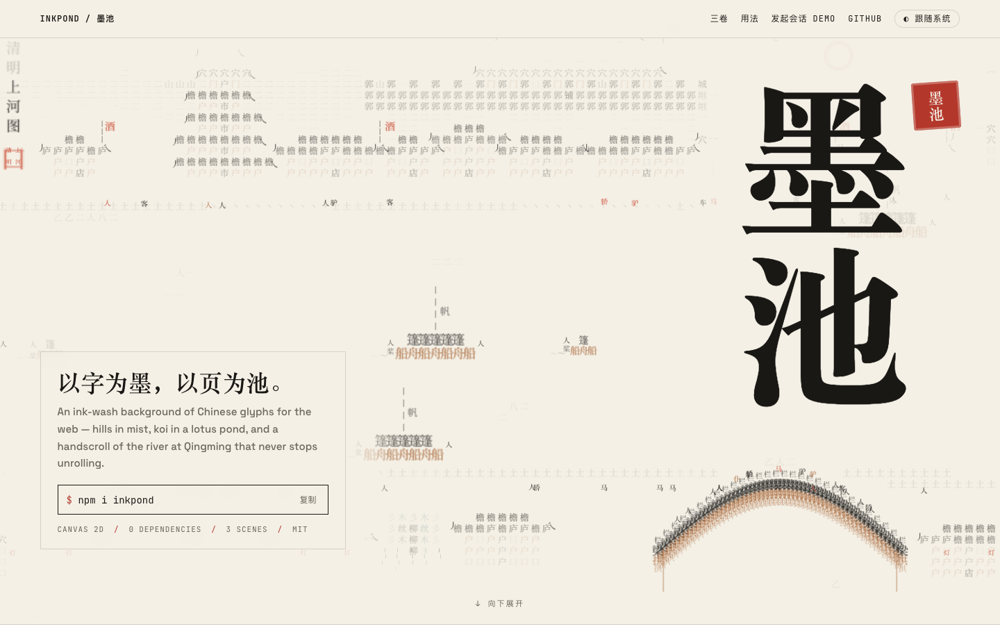
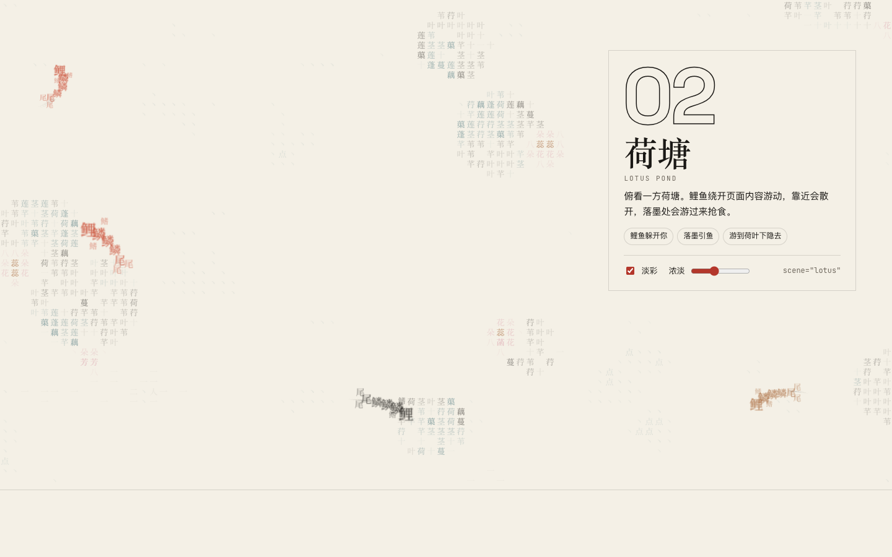
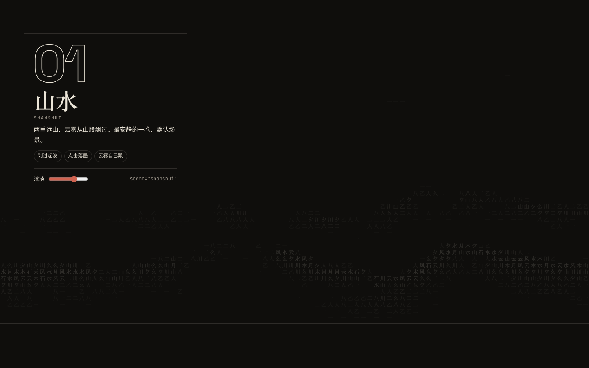

# 墨池 Inkpond

> An ink-wash background of Chinese glyphs for the web. Characters laid out by stroke density become distant hills in mist, a lotus pond with koi, or a slowly unrolling handscroll of *Along the River During the Qingming Festival*. The pointer stirs ripples, a click drops ink, and page content keeps a clear zone. Canvas 2D, zero runtime dependencies, React optional. Inspired by [stackedlol/ascii-sharks](https://github.com/stackedlol/ascii-sharks).
>
> **Live demo: <https://shin4.github.io/inkpond/>**

<picture>
  <source media="(prefers-color-scheme: dark)" srcset="docs/images/hero-dark.png" />
  
</picture>

一层可以铺在任何页面背后的水墨汉字底。汉字按笔画疏密排成画面：默认是远山和流动的云雾，也可以换成鲤鱼游动的荷塘，或缓缓展开的清明上河长卷。鼠标划过会泛起水波，点击空白处会落墨，墨迹晕开后慢慢淡去。只用 Canvas 2D，没有运行时依赖。

仓库里带两个演示页：

- **项目主页**（`demo/index.html`）：整屏清明上河长卷作首屏，下面三卷场景各占一屏，可以调淡彩和浓淡，附用法和性能数据。
- **发起会话**（`demo/session/`）：问候语和输入框，顶栏可以切换场景，也可以隐藏输入组件看完整画面；打字时水面起涟漪，第一次发送时墨在输入框四周晕开、背景退场。

## 场景

| `scene` | 画面 | 会动的东西 |
| --- | --- | --- |
| `shanshui`（默认） | 两重远山，云雾飘过 | 只有云雾 |
| `lotus` | 俯看荷塘：带缺口和叶脉的荷叶、胭脂色荷花、花青浮萍 | 鲤鱼绕开页面内容游动，鼠标靠近会散开，落墨处会游过来；游到荷叶下会隐去大半 |
| `qingming` | 清明上河长卷：群山之下城郭绵延，城楼三重、宝塔五层，山脚没入一带云烟；两岸飞檐屋舍、酒旗灯笼、垂柳；一座宏大的木拱虹桥如原画那样从近岸（下）拱起、越过河面落在远岸（上），近岸桥头是伞棚车马的集市，桥边一条大船正放倒桅杆；画面底边压着几道放大的近景屋檐 | 长卷每秒向左展开 7px，船夫撑船往来，行人走街过桥，飞鸟掠过，酒旗柳丝随风摆；在岸上落墨会惊散附近的人 |

荷塘和清明上河用一点淡彩（朱、胭脂、赭石、花青），设 `tint={false}` 就只用墨色。

| 荷塘 | 山水（暗色） |
| --- | --- |
|  |  |

项目主页在线地址：<https://shin4.github.io/inkpond/>（发起会话演示：<https://shin4.github.io/inkpond/session/>）。源码在 `demo/index.html`，本地 `bun run dev` 即可打开；每次推送到 `main` 都会通过 `.github/workflows/pages.yml` 重新部署。

## 快速开始

```bash
bun install
bun run dev          # 项目主页 http://localhost:5173/ ，发起会话 /session/
bun run test         # 单元测试
bun run build        # 输出库到 dist/
bun run build:demo   # 输出演示页到 dist-demo/
```

## 安装

还没有发布到 npm，目前直接从 GitHub 安装，安装时会自动构建出 `dist/`：

```bash
npm i github:shin4/inkpond
```

- npm 11 会对带构建脚本的依赖给出 `allow-scripts` 提示，安装照常完成；如果你的 npm 配置禁止依赖运行脚本，执行 `npm approve-scripts inkpond` 允许它即可。
- 想固定版本，在地址后面加上提交或标签，例如 `github:shin4/inkpond#<commit>`。

## 在 React 里用

```tsx
import { InkPond } from "inkpond/react";
import "inkpond/inkpond.css";

<main style={{ position: "relative" }}>
  <InkPond active={isEmpty} />
  <div className="content">
    <section data-inkpond-avoid="">…问候语…</section>
    <form data-inkpond-avoid="">…输入框…</form>
  </div>
</main>
```

- 画布铺满**最近的定位父元素**，并从这个父元素接收鼠标事件。
- 父元素里带 `data-inkpond-avoid` 的元素周围会自动留白，后来才出现的元素也会被识别。
- `active` 表示这一块当前是否在屏幕上；标签页切到后台时会自动暂停，不用自己处理。
- 其他选项只在挂载时读一次，想改就换一个 `key` 重新挂载。
- 想在代码里拨动水面，传一个 `pondRef`（见下文「主动触发」）。

## 不用 React

```ts
import { createInkPond } from "inkpond";
import "inkpond/inkpond.css";

const pond = createInkPond(document.querySelector("canvas.inkpond")!, {
  strength: 0.45,
});
pond.setActive(false); // 这一块被隐藏时
pond.destroy();        // 卸载时
```

## 主动触发

除了鼠标，页面自己也可以拨动水面，比如输入时起涟漪、发送时落墨。坐标都是视口坐标（`clientX` / `clientY`）：

```ts
pond.ripple(x, y, 0.4); // 一圈水波，强度 0–1，默认 1
pond.drop(x, y);        // 落墨；落在留白元素上会被拒绝，返回 false
```

在 React 里用 `pondRef` 拿到同一个对象：

```tsx
const pondRef = useRef<InkPond | null>(null); // InkPond 类型来自 "inkpond"
<InkPond pondRef={pondRef} />
// 之后：pondRef.current?.ripple(x, y)
```

暂停、减少动画模式和静帧档下，这两个调用都不生效。演示页里的输入框就是这样联动的：打字时从输入框边缘荡开水波，聚焦时水面泛起一圈，第一次发送时墨在输入框四周晕开，背景随后淡出。

## 选项

| 选项 | 默认值 | 说明 |
| --- | --- | --- |
| `scene` | `"shanshui"` | 画面，见上文「场景」 |
| `tint` | `true` | 是否画淡彩；`false` 只用墨色 |
| `active` | `true` | 是否在屏幕上；后台标签页总会暂停 |
| `strength` | `0.45` | 场景画面的墨色浓淡。水波和墨迹不受影响 |
| `waveSpeed` | `1` | 水波速度倍数，1 是慢慢荡开的效果 |
| `levels` | 场景自带 | 替换场景主地面（山水的山、荷塘和清明的水面）的字表，从淡到浓。换字需要自备覆盖这些字的字体 |
| `reducedMotion` | 跟随系统 | 开启后只画一张静止画面，不响应鼠标 |
| `avoidAttribute` | `data-inkpond-avoid` | 标记留白区域用的属性名 |
| `avoidPadding` | `20` | 留白元素四周完全空出的宽度（CSS px） |
| `avoidFade` | `140` | 留白边缘墨色渐渐恢复的过渡宽度（CSS px） |
| `fontUrl` | 场景自带子集 | 设为 `null` 时只用后备字体 |
| `fontFamily` / `fallbackFonts` | 场景自带 / 宋体系 | 字体名和后备字体 |
| `tierStorageKey` | `inkpond.tier` | 记住降级档位用的 localStorage 键；`null` 表示不记 |

**颜色**：墨色取画布的 `color`，可以用 CSS 变量 `--inkpond-ink` 设置；`--inkpond-alpha` 是画面最深处的不透明度。淡彩来自 `--inkpond-zhu`（朱）、`--inkpond-yanzhi`（胭脂）、`--inkpond-zhe`（赭石）、`--inkpond-huaqing`（花青）。`inkpond.css` 已经处理了 `prefers-color-scheme`，以及 `<html>` 上的 `.dark` / `data-theme="dark"`，暗色下淡彩会更亮一些。主题切换后颜色会自动更新。

## 山水字表

| 档位 | 字 |
| --- | --- |
| 1（最淡） | 一 |
| 2 | 二 人 八 乙 |
| 3 | 川 山 夕 么 |
| 4 | 水 云 风 月 石 木 |
| 5 | 雨 泉 波 松 苔 星 |
| 6 | 流 浪 深 涧 峰 |
| 7 | 渊 潮 雾 澜 溪 森 晶 |
| 8（最浓） | 墨 瀚 灏 澹 濛 麒 |

## 性能

- **省下来的开销**：每个字只栅格化一次，存进图集，之后每帧只贴图；远山和留白区域按窗口尺寸预先算好；云雾在粗网格上插值；每滴墨只计算它影响范围内的格子。
- **按画面状态降帧**：水在动时按当前档位的帧率画；只有鱼、船或长卷在动时约每秒 20–24 帧；只有云雾在飘时降到每秒 10 帧；30 秒没有操作就停在当前画面（鱼和船停在原处），鼠标一动立即恢复。
- **图集不横向撑爆**：图集按 16 列排成网格，清明场景在 DPR 2 下是 640×1400px，而不是一行近 4000px（不少移动 GPU 的纹理上限是 4096px）。
- **三个档位**：
  - 标准：60 帧，字格 16px，清晰度上限 1.5 倍
  - 轻量：30 帧，字格 22px，清晰度上限 1.25 倍
  - 静帧：只画一张静止画面
- **起始档位**：通过 WebGL 探测到软件渲染（SwiftShader、llvmpipe、Microsoft Basic Render Driver 等）时，直接从静帧开始；CPU 不超过 4 核或内存不超过 4 GB 的设备从轻量开始。
- **实测**（无头 Chrome，1920×1080，DPR 1.5，每帧脚本耗时中位数 / p95）：

  | 场景 | 静水 | 鼠标持续搅动全屏 | 慢变层重算（每 4 帧一次） |
  | --- | --- | --- | --- |
  | 山水 | 0.2 / 0.3 ms | 0.9 / 1.8 ms | 0.1 ms |
  | 荷塘 | 0.2 / 0.3 ms | 1.1 / 1.9 ms | < 0.1 ms |
  | 清明上河 | 0.7 / 0.9 ms | 1.3 / 1.7 ms | 0.2 ms |

  每帧预算是 8 ms。开销几乎全在贴图调用；关掉 GPU 用 CPU 光栅化时，满屏搅动约 9 ms，这正是起始档位和自动降级要处理的情况。
- **自动降级**：最近 10 帧的中位数超过 16 ms，或帧间隔超过 60 ms，直接切到静帧；每 60 帧统计一次，p95 超过 8 ms 或帧间隔超过 40 ms，就降一档。降级结果在这台设备上记 30 天。

## 致谢

墨池的想法来自 [stackedlol/ascii-sharks](https://github.com/stackedlol/ascii-sharks)：用字符在页面背后养一片会游动、会躲开内容、会回应鼠标的海。墨池把这个想法换成了水墨和汉字，代码从头写起，没有使用原仓库的代码。感谢原作者 [@stackedlol](https://github.com/stackedlol) 的创意。

## 字体与许可

每个场景带一个思源宋体 SC Medium（Source Han Serif，SIL OFL 1.1）的子集，只含这个场景用到的字，用到哪个场景才加载哪个：

| 文件 | 字数 | 大小 |
| --- | --- | --- |
| `inkpond-shanshui.woff2` | 39 | 约 10 KiB |
| `inkpond-lotus.woff2` | 66 | 约 16 KiB |
| `inkpond-qingming.woff2` | 101 | 约 21 KiB |

按 OFL 的规定，修改过的版本不能继续使用保留字体名「Source」，所以这些子集都改名为 **Inkpond Glyphs**。许可全文和修改说明见 `src/assets/OFL.txt`。

改了任何场景用到的字之后，用原版 OTF 重新生成全部子集（需要 `bun` 和 `uv`；原版字体可从 Adobe 的 `adobe-fonts/source-han-serif` 仓库获取）：

```bash
scripts/build-font.sh path/to/SourceHanSerifSC-Medium.otf
```

本项目代码以 [MIT](LICENSE) 许可发布；字体子集仍按 SIL OFL 1.1 授权，两者分开适用。

## 目录

```
src/
  engine.ts      各场景共用的模拟与绘制：水波、落墨、留白、图集、平移
  scene.ts       场景契约、淡彩颜料、字表工具
  scenes/        山水、荷塘、清明上河
  noise.ts       噪声与随机数
  controller.ts  帧循环、鼠标输入、留白区、字体、主题、性能档位
  tiers.ts       档位与降级判定
  glyphs.ts      山水字表与字体常量
  react.tsx      React 组件
  inkpond.css    画布定位、暗色和高对比度处理
demo/            项目主页（Landing）与发起会话演示（session/）
tests/           Vitest 测试
scripts/         各场景字体子集生成
```
